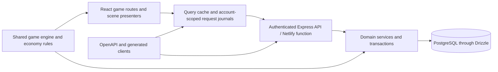

# Architecture audit and beta release roadmap

**Snapshot:** October 24, 2026; source commit `61e9a86c1bd1ba49e350bd4a488671ab37d26ad2`. Scope: the active release worktree, frontend/API/shared-engine source, checked-in release scripts, design contracts and bounded local checks. Production hosting configuration, current deployment health, live accounts, real-money transactions and physical devices were not inspected.

**Assessment:** Squabblemon has a substantial, visually distinctive beta foundation with real performance and transaction safeguards. The remaining work includes compatibility, release-gate coverage, interaction accessibility and operational validation. Calling the repository uniformly optimized, independently hot-swappable, or only in cosmetic polish would overstate the evidence. “80–90%” is a product impression until the release journeys and acceptance criteria define its denominator; this audit does not assign a completion percentage.

The adopted [engineering standards](../../design/engineering-standards.md) preserve the creative direction while making its claims testable. Existing [UI principles](../../design/game-ui-principles.md) and [popup contracts](../../design/popup-design-system.md) remain authoritative for their specific concerns.

## Architecture and ownership

This is a **modular monolith**: frontend routes are split, domain services have useful boundaries, and the client/API share rules and deploy together. The OpenAPI path covers part of the API; hand-written reward and multiplayer contracts are a documented gap below. There is no need to split the project into microservices to improve this beta.

| Area | Existing foundation | Evidence |
|---|---|---|
| Application loading | Deferred application/game routes; destination preparation on navigation intent | [App](../../artifacts/squabblemon/src/App.tsx), [routeModules](../../artifacts/squabblemon/src/pages/game/routeModules.ts), [GameApp](../../artifacts/squabblemon/src/pages/game/GameApp.tsx) |
| Client state | Shared query cache; cache cleared on account change; saved pack intent and receipts | [App, lines 94–120](../../artifacts/squabblemon/src/App.tsx), [packJournal](../../artifacts/squabblemon/src/lib/packJournal.ts) |
| Economy authority | Player locks, original-receipt replay, atomic wallet/inventory/pity/milestones; database uniqueness | [collectionTransactions, line 49 onward](../../artifacts/api-server/src/lib/collectionTransactions.ts), [shopTransactions](../../artifacts/api-server/src/lib/shopTransactions.ts), [pack schema](../../lib/db/src/schema/playerPackOpenings.ts) |
| Paid fulfillment | Provider verification and durable fulfillment identity separated from visual receipts | [payment service](../../artifacts/api-server/src/lib/payments/service.ts) |
| Visual system | Reusable materials and type roles with specialized scene presenters | [popup primitives](../../artifacts/squabblemon/src/components/ui/game-popup.tsx), [popup design contract](../../design/popup-design-system.md) |
| Media | Bounded artwork preparation; explicit frame, visibility, playback and disposal lifecycle | [KeyedVideo](../../artifacts/squabblemon/src/components/KeyedVideo.tsx), [gacha direction](../../design/gacha-cinematic.md) |
| Release | Types, selected engine/online/story checks, migration coverage, built function smoke and JS budgets | [publication sequence, lines 58–85](../../scripts/build-netlify.mjs) |

These boundaries support further development. They do not prove uniform component quality, zero runtime coupling, or safe changes without integration tests.

## Evidence collected in this audit

- A fresh local frontend production build passed, including story-music metadata validation, bundle budgets and emitted CSS/panel guards. It retained the Story chunk advisory at 575.14 kB. This was the frontend package build, not a hosted deployment or the complete Netlify publication sequence.
- Native migration **coverage** passed: 23 tables across 17 migration files. This command did not execute migrations against a hosted or temporary database.
- The focused pull-payment test file passed. Existing phone/desktop purchase fixtures and five viewport reports were inspected from the preceding implementation pass; they were not rerun as part of this audit.
- A bounded engine probe accepted a valid end-turn under rules version 63, rejected the same command under version 62, and then expired that stale room to a timeout with the rival as winner. Ranked-service persistence was traced in source only; no database or network operation was executed. The temporary reproduction is preserved locally under `output/architecture-audit-20261024/`.
- Source checks established the other findings below. Runtime hypotheses and operational gaps are labeled; no live incident or player-impact rate is inferred.

| Current built JS scope | Measured | Enforced ceiling |
|---|---:|---:|
| Public entry, transitive static JS | 211.5 KiB | 475 KiB |
| GameApp, transitive static JS | 650.6 KiB | 900 KiB |
| Home, transitive static JS | 956.1 KiB | 1,200 KiB |

These scopes overlap; do not sum them. The [bundle guard](../../artifacts/squabblemon/scripts/check-entry-bundle.mjs) defines the measurement. They do not include total route media/CSS costs or measure network latency, frame smoothness or battery use. Fresh build log: local `output/architecture-audit-build-20261024.log` in the primary workspace. Earlier release evidence and its limitations are recorded in [design-update-release](../design-update-release.md).

## Prioritized findings

### A1 · P1 · Retire incompatible live rooms safely

[applyOnlineCommand](../../lib/squabblemon-engine/src/multiplayer.ts), lines 239–248, rejects every command when a room uses an older rules version. The service's [room operation](../../artifacts/api-server/src/lib/onlineMatches.ts), lines 244–245, advances bots and expires the room before that compatibility check. [Expiration](../../lib/squabblemon-engine/src/multiplayer.ts), lines 172–185, can declare a timeout winner; [ranked settlement](../../artifacts/api-server/src/lib/onlineMatches.ts), line 395 onward, accepts completed rooms without a compatibility check. A deployment that changes the rules version can therefore block further play and still lead to a timeout result. A bounded engine reproduction confirmed the rejection and timeout behavior. Service settlement and persistence were confirmed by source tracing at lines 324–346; no service/database execution or production incident is claimed.

**Exit:** decide between supported version pinning and neutral retirement, then check compatibility before advancement, expiration and settlement. Previous-version human, bot and Kumite cases must allow a recoverable exit without deployment-caused rank changes or new rewards. Verify under the normal room transaction and reconnect path.

### A2 · P1 · Make release verification consistent and explicit

The Netlify release chain is substantial, but [build-netlify.mjs](../../scripts/build-netlify.mjs), lines 82–84, calls Vite directly and the bundle guard. It omits the story-music check and emitted CSS/panel guard in the [frontend build command](../../artifacts/squabblemon/package.json). Native PostgreSQL payment, monthly-login, ranked and flexible-pull tests and migration execution/replay are also separate commands. The explicit frontend default test list omits newer tests including `pullPayment.test.ts` and `packGymFilm.test.ts`. No checked-in GitHub workflow establishes a second required gate; external CI settings were not inspected.

**Exit:** maintain one shared release-check inventory used by local and deployed builds. Include fast critical tests automatically; require affected native transaction suites and a shared-wallet regression tier for economy changes, and native replay for SQL changes. Deliberately stale music, forbidden CSS and a failed critical helper must block the gate. Bind the evidence to the release SHA and record unexpected skips as failures.

### A3 · P1 · Complete modal and motion behavior across legacy surfaces

The [Story rewards panel](../../artifacts/squabblemon/src/pages/game/Story.tsx), lines 152–159 and 445–466, declares modality and handles Escape but does not provide native/Radix modality, initial focus, a focus trap, background inertness or focus return. [CardInspector](../../artifacts/squabblemon/src/components/CardInspector.tsx) already supplies a stronger reference. Separately, [App](../../artifacts/squabblemon/src/App.tsx), line 162, uses OS-driven Framer Motion preferences, while [GameApp](../../artifacts/squabblemon/src/pages/game/GameApp.tsx), lines 95–98, maps the saved game setting to CSS. Unconditional Framer travel/scale in Story rewards and [RulesModal](../../artifacts/squabblemon/src/components/RulesModal.tsx) can bypass a saved game preference.

Some controls also fall below the project's practical 44px target: phone [banner arrows](../../artifacts/squabblemon/src/styles/pull-banners.css), line 170, are 25px wide; the [Story close control](../../artifacts/squabblemon/src/styles/story-rewards.css), line 27, is 35×35px. These are source findings; computed geometry and keyboard behavior need real-route verification before calling them resolved.

**Exit:** focus enters and stays in open dialogs, background interaction is unavailable, and dismissal returns focus. Either OS or saved reduced motion suppresses large travel/scale/parallax while retaining all information. Check all four preference combinations. Keep small artwork within adequate hit regions, without overlapping neighboring actions. Verify keyboard, screen reader, touch, text enlargement, 320px phone and short landscape. Preserve the current visual materials.

### A4 · P2 · Close API contract gaps

Account rewards and multiplayer are outside the current [OpenAPI document](../../lib/api-spec/openapi.yaml). [DailyCheckInArrival](../../artifacts/squabblemon/src/components/DailyCheckInArrival.tsx) trusts a hand-written response type, and the [multiplayer route](../../artifacts/api-server/src/routes/multiplayer.ts) returns an unknown service payload. Shared compilation does not validate the JSON crossing deployed versions.

**Exit:** define and test request, response and error schemas, add generated-output drift checks, and exercise current/previous-client fixtures for optional reward fields, private room projections and saved-receipt recovery. Preserve existing authorization and request identities.

### A5 · P2 · Make failures diagnosable and operational readiness measurable

[Account reward handlers](../../artifacts/api-server/src/routes/accountRewards.ts), lines 34 and 49, discard caught causes; [app.ts](../../artifacts/api-server/src/app.ts), line 112, has no terminal API-wide JSON error handler after the router. Existing redacted logging and store diagnostics are useful, but failure shapes and traceability differ by route. The [Homies diagnostics contract](../homies-diagnostics.md), lines 104–111, explicitly says its sampled/rate-limited records cannot establish production percentiles or capacity.

**Exit:** use a safe error envelope and request identity with redacted server causes. Inject a failure after commit but before response and prove the retry returns the saved result once. Establish actual deployment health, rollback steps and aggregate latency/error evidence before promising a production SLO; do not derive those claims from fixture timings or biased samples.

### A6 · P2 · Profile broader state work and expand budget coverage before extracting modules

[Notifications](../../artifacts/squabblemon/src/components/Notifications.tsx), lines 66–69, polls reward endpoints and invalidates the full bootstrap every visible minute. [CosmeticState](../../artifacts/squabblemon/src/components/cosmeticState.tsx) publishes the whole profile. These are plausible sources of unrelated work, not a measured regression in this audit. [Shop's PackGym](../../artifacts/squabblemon/src/pages/game/Shop.tsx) still combines recovery, payment, schedule, audio, cinema and rendering; [Story](../../artifacts/squabblemon/src/pages/game/Story.tsx) combines several presentation modes. [gameStyles](../../artifacts/squabblemon/src/pages/game/gameStyles.ts) deliberately loads a broad stable cascade.

Existing JS budgets cover entry, shell and Home, not full Shop/Story/CSS/media delivery. The [throttled battle harness](../../artifacts/squabblemon/scripts/battle-performance.mjs), lines 91–94, permits p95 frames of 125/175 ms and a 65% fraction above its dropped-frame threshold. These are current stress-harness ceilings, not a claim of consistently smooth physical-phone play.

**Exit:** profile a populated two-minute battle with real shell providers, and cold/warm Shop and Story entry. Attribute unnecessary refreshes/renders before changing them. Set explicit device-tier goals and route/media/CSS budgets from retained baselines. Extract purchase/recovery orchestration and scene boundaries incrementally, preserving retry, account, receipt and artwork behavior. Prove meaningful savings; do not split code solely to improve file counts.

## Gameplay evidence follow-up — October 25

The initial v63 baseline completed 20,400 automated matches. The subsequent [v64 policy-corrected refresh](../../artifacts/deliverables/current-deck-audit-20261025-v64/README.md) completed 20,368 matches, with all 301 playable cards observed naturally and 46 named recipes exported. Older rankings are historical; current-source checks reject stale evidence. No numerical card balance change was made.

The [October 25 hardening follow-up](beta-hardening-2026-10-25.md) implements neutral room/Kumite retirement and checkpoint/completion recovery for A1, the common build gate/inventory for A2, current-rule CPU choices, stale tutorial-stat corrections and responsive journey checks. A1/A2 local evidence does not imply hosted deployment. The original findings above remain a dated audit, not a claim that every A3–A6 item is resolved. Physical devices, authenticated staging and human playtests remain separate open gates.

## Sequence to a release decision

| Wave | Work | Acceptance evidence |
|---|---|---|
| 0. Refresh gameplay evidence | Current rules/roster deck matrix, catalog probes, guidance and named reports | Successful complete runs with source/plan fingerprints; obsolete reports labeled historical; [current evidence index](../balance/README.md) passes its freshness check |
| 1. Protect progression | A1 compatibility; A2 shared release gates | Previous-version rooms recover neutrally; affected native transactions and migration replay pass; intentionally broken critical checks block release |
| 2. Unify interaction behavior | A3 focus, motion and touch geometry | Real-route keyboard/touch/reduced-motion matrix, full reward reachability and preserved art |
| 3. Stabilize contracts and performance | A4 schemas; A5 traceable failures; measured portions of A6 | Current/previous payloads; post-commit recovery; cold/warm and populated-battle baselines with attributed improvements |
| 4. Validate the complete release | Physical phones/tablets, authenticated staging, two real clients, interrupted network and update/reconnect journeys | One revision-linked record covering sign-in → play → reward → revisit, exact balances, late response/account change, safe navigation and rollback |

Prioritize targeted fixes over a broad rewrite. Additional cosmetics follow the blocking journeys and recurring player feedback. Module extraction is useful only where it makes these changes safer or measurably cheaper.

## Definition of ready

A release decision requires passed and revision-linked evidence for the agreed critical journeys; no unresolved blocker that can lose progression, duplicate a charge or make an essential control unreachable; verified affected database/contract behavior; and a matching ready deployment. Screen-reader/physical-device checks and real two-client network journeys remain **open**, not implicitly passed by Chromium fixtures.

Record each gate as passed, failed, or not run, with its environment and scope. Keep creative approval separate from runtime correctness and deployment confirmation. The final gap is a finite verification backlog, not a claim of “100%” perfection.
