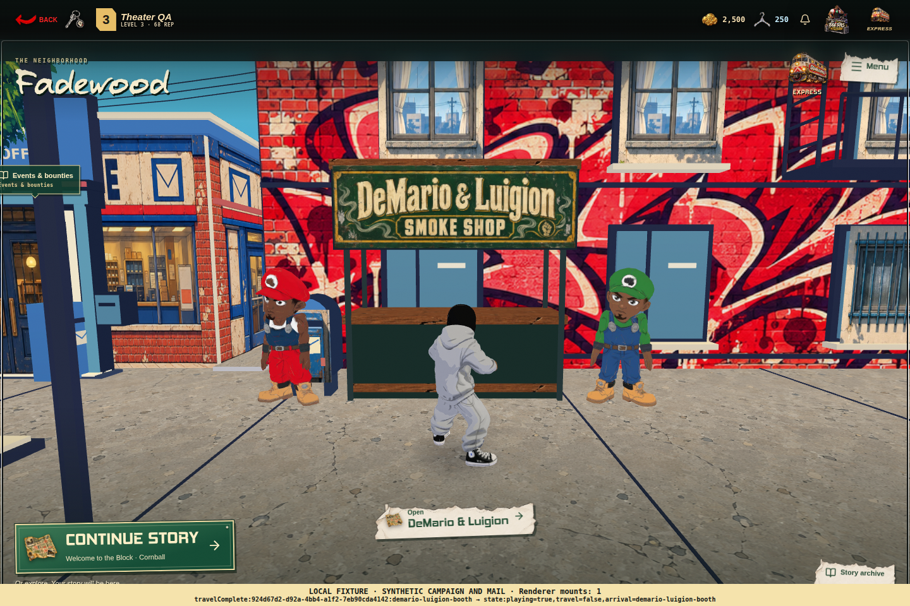

# Fadewood world integration

Fadewood replaces the old Story entry with the authored 3D neighborhood while retaining the existing Story reader, saved dialogue line, battles, rewards and account state. This release is being combined with PR #21's Anunaki expansion and Kumite Breakthrough beta foundation.

## Player flow

- Continue Story travels to the relevant story-arc host. Arrival offers a choice to continue or keep exploring; it never starts dialogue automatically. Chapter/node participants track dynamically within that arc rather than assigning a new NPC to every chapter.
- The Anunaki expansion uses the UFO as its host. All eight canonical chapter IDs map to it. Existing saved chapter/node/line identities remain authoritative.
- Express uses the existing illustrated travel design. Conversations finish their cinematic camera move before showing contextual character/arc posters. Street-sign and paper controls reuse the established popup typography and materials.
- Safehouse entry goes directly into Home. Street and room day/night preferences are shared; night panorama/near-neighborhood artwork loads on intent. Returning restores the saved outside location.
- The Fade Park board routes to Events and Bounties. Mailman flies to the player when attention is waiting, lands into a live idle, and uses the existing mail UI/claim endpoints. Normal reward/arrival overlays remain available in the world.
- Nova is a dismiss-only memorial interaction with no game destination. DeMario and Luigion's timber smoke-shop booth is behind Squabble House, left of the blue Crib. Their proposed chapter remains marked as in development.

## A living neighborhood

Twelve standing humanoids missing a calm idle use a bind-aware derivative of the existing Yasuke breathing/look-around clip. Authored native idles and Leon's supported reclining pose remain available. Both OGs perform their full authored lower → six push-ups → stand → idle sequence, with a getting-up transition when approached. Other NPCs alternate fitting native gestures, training or dancing with quiet intervals. DeMario occasionally waves.

Dogs use bounded shortest-arc turning and gait blended to actual movement instead of pivoting toward nearby players. Quiet breathing/head/tail motion continues when stopped. Conversation focus holds Nova's pose and keeps his memorial still.

The booth's beige cap, lower strip and canopy now use the existing Safehouse timber artwork at physical UV scale. One shared material adds one draw; the helper with both hosts uses six draws and five active textures. Five animation-only GLBs restore ten exact authored clips in 993,872 bytes without duplicate meshes/textures. The shared idle source is 85,135 bytes. Scene work shares the existing clock and frame loop, pauses with menus/visibility, and respects reduced motion.

## Progression and future character customization

The beginner roadmap keeps the first two current chapters, reserves Blood vs Crip and then DeMario/Luigion as proposed opening chapters, and presents later arcs/features through the existing progression data. Reserved chapters do not reset existing accounts or pretend to be playable. The new-player gate changes remain planned until their content and reward rules are authored.

The player appearance contract separates model, palette and future body/gender selections. The initial scaffold is additive; future selectable models/palette swaps need their actual assets and acceptance checks. It does not replace account inventory or manufacture cosmetic grants.

## Reproducibility and validation

Runtime source is in `artifacts/squabblemon/worlds/fadewood`; checked-in delivery is in `artifacts/squabblemon/public/scenes/fadewood`. The relative asset symlink resolves inside this repository. The integrity gate compares source and delivery hashes without Python bytecode/cache files, so fresh checkouts do not require the authoring machine's caches or Blender install. Build the child with its pinned nested package when runtime source changes; the parent release validates the checked-in delivery.

The prior world candidate passed 386 required tests, 80 affected runtime cases and 55 frontend-Three compatibility cases. Desktop and phone software-renderer fixtures verified real bone motion, landed Mailman, smooth dog turns, Story save/resume/choice, wood assets, direct Safehouse entry, shared lighting, restored checkpoint and Nova. Full OG cycles were observed on desktop; phone exercised passive phases and interactions. These are synthetic local account/API fixtures, not live-account or physical-device proof.

Combined-PR verification includes all 16 critical suites and 19 required source checks, plus TypeScript, deployment packaging and migration-coverage checks. Final run results and hosted deployment state are recorded on [PR #21](https://github.com/guapdad4000/squabblemon-v3/pull/21). Breakthrough's public queue/unsupported-card gate, Anunaki banner calendar and existing tester-code switches retain their reviewed policies; this integration does not enable grants, broadcasts or unfinished transport.

[Prior renderer summary](fadewood-world-evidence/prior-world-render-checks.json) · [World-art provenance](fadewood-world-evidence/world-art-provenance.json) · [Image-generation prompts](fadewood-world-evidence/imagegen-prompts.json) · [Blender preview](fadewood-world-evidence/blender-source-preview.png).

Packed editable Blender files and raw review traces are preserved locally outside the Git release scope. The original supplied Blender master is unchanged.

